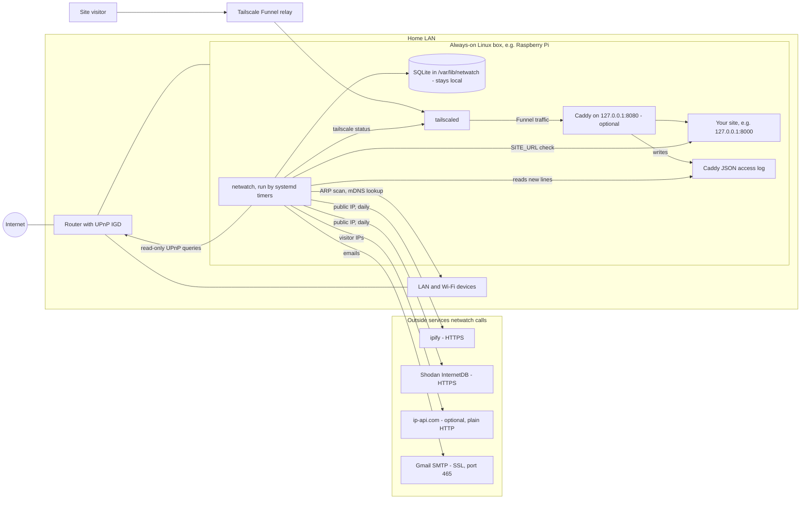
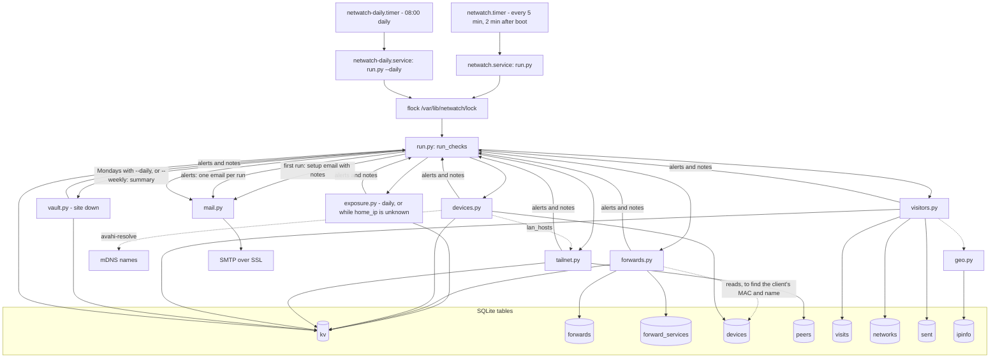
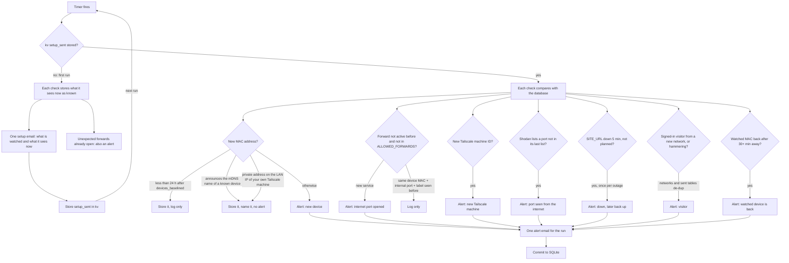
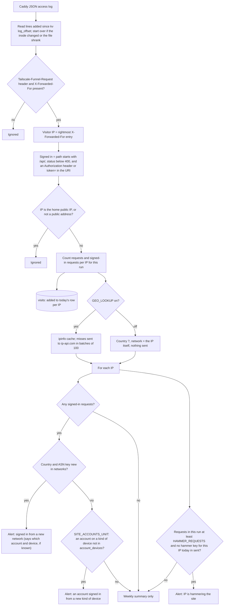

# Architecture

How Home Network Watch is set up and how it works. For installation, see [DEPLOY.md](DEPLOY.md).

netwatch is a set of short-lived Python runs (stdlib only) started by systemd timers on one always-on Linux
box on the home LAN. It listens on no port. Each run looks at the network, compares what it sees with what
it saved last time in a local SQLite file, and emails only the differences.

## Deployment and network topology

The box is not in the traffic path. It sees the network only through:

- an ARP scan of `LAN_IFACE` (`arp-scan --localnet`),
- one batched mDNS (Bonjour) reverse lookup of the IPs it found (`avahi-resolve -a`, if installed), for the
  names devices announce,
- UPnP requests to the router at `ROUTER_IP:UPNP_PORT`: one GET of the device description, then
  `GetGenericPortMappingEntry` for index 0, 1, 2, ... until the router returns an error (at most 500),
- `tailscale status --json`, plus `tailscale ping -c 1` to online peers when a new private Wi-Fi address
  needs to be matched to one of your Tailscale machines (see [the lifecycle](#baseline-then-alert-lifecycle)),
- an HTTP GET of `SITE_URL`, if set,
- the Caddy access log, if `CADDY_LOG` exists,
- `journalctl -u SITE_ACCOUNTS_UNIT` (the site backend's log since the last run), if set.

The site part is optional. Visitors reach it through Tailscale Funnel, which hands requests to Caddy on the
box; Caddy writes a JSON access log that netwatch reads. The router has no port forward for it.

## Components

- **Timers.** `netwatch.timer` runs the fast checks every 5 minutes. `netwatch-daily.timer` runs at 08:00
  local time (up to 10 minutes random delay, `Persistent=true` so a missed run happens after boot) with
  `--daily`, which adds the outside scan; on Mondays that run also sends the weekly summary (UPnP state, open
  forwards, Shodan ports, devices seen, visitors and, if `PC_REPORT` is set, when a PC last checked in). Both services
  take the same `flock`, so runs never overlap (the `nw` helper takes it too).
- **run.py** runs, in order: `exposure` (only with `--daily`, or when `home_ip` is not stored yet, such as
  the first run), then `devices`, `forwards`, `tailnet`, `visitors`, `vault`. `devices` goes before
  `forwards` so a forward's client IP can be matched to a MAC from this run's scan. Each `check()` returns
  `(alerts, notes)`. A check that raises is logged as `check failed: <name>: <error>`, and the others still run.
- **Alerts** are `(title, body)` pairs; all alerts of a run go into one email. **Notes** describe the
  current state. They go into the setup email on the first run; after that they are only printed to the
  journal (for example "Home public IP changed").
- **Committing.** The database is committed only after the emails are sent. If sending fails, the run's
  changes are lost and the next run finds the same changes and tries again. `--dry-run` runs every check
  (including its outside calls), prints alerts and notes, and rolls back.
- Optional checks switch themselves off: no `tailscale` binary, no `CADDY_LOG` file, empty `SITE_URL`.

## Baseline-then-alert lifecycle

The first run (no `setup_sent` in `kv`) sends a single "Home network watch is set up" email listing what is
watched and everything each check saw. Each check keeps its own baseline marker, so a check that failed on
the first run sets its baseline the first time it works; its notes then go only to the journal.

How each check decides that something is new, and so never alerts twice for the same thing:

| Check | Known state | Alerts when | Repeats |
|---|---|---|---|
| Port forwards | `forwards` rows with `active = 1`; `forward_services` (device MAC, protocol, internal port, label) | a mapping key (`TCP:8000`) is not active, its UPnP label does not start with an `ALLOWED_FORWARDS` entry, and its service is not in `forward_services` | never for the same service on the same device; on the first run, unexpected open ones alert once |
| Devices | `devices` (by MAC, kept forever) | a MAC never seen, after the 24 h learning window, that isn't recognized (below) | never for the same MAC |
| Watched devices | `devices.watch = 1` | a watched MAC is back after 30+ minutes unseen | every time it comes back |
| Tailscale | `peers` (by node ID) | an ID never seen; Funnel relay nodes are ignored | never for the same ID |
| Shodan | `kv shodan_ports` | a port is in Shodan's list but was not in the previous list | again if it drops off the list and comes back |
| Site down | `kv vault_down_since`, `vault_alerted` | down for 5+ minutes (two runs) and `MAINT_DIR/active.json` is absent; then "back up" | once per outage |
| Visitors | `networks`, `sent` | see [the visitor pipeline](#visitor-pipeline) | once per network ever; hammering once per IP per day |

Devices have a learning window: for 24 hours after the first device scan (`kv devices_baselined`), new MACs
are stored but only logged, so devices that were asleep at the first scan join quietly. After that, a new
MAC is recognized, named and not alerted when:

1. it announces the mDNS name of a device already in `devices.hostname` (case-insensitive). Generic names
   in `GENERIC_NAMES` (`Android`, `iPhone`, `raspberrypi`, ...) don't count. Or
2. it is a private (randomized) MAC that holds the LAN IP of one of your Tailscale machines
   (`tailscale status`, after a `tailscale ping` to online peers without a known LAN address).

Any other new MAC alerts. Each run also stores the mDNS name each device announces in `devices.hostname`.

A forward is identified by what it reaches: the client's MAC (looked up in `devices` by IP; `ip:<addr>` if
unknown), protocol, internal port and UPnP label. The same service coming back after a router reset, on a
new DHCP address or a new outside port, is only logged. Forwards stored before this tracking existed are
copied in once with device `*` (kv `services_seeded`), so they count as known for any device.

`nw devices --watch MAC` sets `devices.watch`. A watched device alerts each time it shows up after being
unseen for 30+ minutes (`WATCH_AWAY_SECONDS`); `--unwatch` stops it.

The visitor check has no quiet first run. On its first run it reads the whole existing log, and each
signed-in network in it alerts once.

## Visitor pipeline

- Reading stops at the last complete line; a half-written line is read on the next run.
- Only requests that carry Funnel's `Tailscale-Funnel-Request` header count. Requests reaching Caddy any
  other way are ignored.
- The visitor IP is the last comma-separated entry of the last `X-Forwarded-For` value (see
  [why](#trust-and-security)).
- Signed in is a heuristic: a successful (`status < 400`) request to a path starting with `/api/` that has an
  `Authorization` header (Caddy logs it as `REDACTED`) or `token=` in the URI. Cookie-only sign-ins count as
  anonymous.
- Skipped: the home public IP (`kv home_ip`, refreshed by the daily outside scan) and any address that is
  not globally routable (private, loopback, link-local, the `100.64.0.0/10` range Tailscale uses, and so on).
- A network is `country code|ASN`, for example `US|AS64500`. With `GEO_LOOKUP=off` it is `??|<ip>`, so each
  new IP that signs in counts as a new network. `nw visitors --name <key> <name>` labels a network for the
  weekly summary.
- Geo results are cached in `ipinfo` with no expiry (the `ts` column is stored but not used).
- With `SITE_ACCOUNTS_UNIT`, the backend's lines (`ip=`, `email=` or `user=`, `ua="<browser> <n>/<OS>"`) give
  the account behind each IP. The kind of device is the backend's `ua` without the version ("Chrome on
  Windows", "iOS app" for an app's web view), or the same summary of Caddy's `User-Agent` when the backend
  has none. Sign-ins from home, the LAN and Tailscale addresses are only learned into `account_devices`.
  The first run reads the last 30 days and learns everything quietly (`kv account_devices_from`).
- Anonymous visitors never alert unless they hammer. They appear in the weekly summary, counted by country,
  with the top 10 IPs listed.

## SQLite schema

One file, `DB_PATH` (default `/var/lib/netwatch/netwatch.db`), in WAL mode. Tables are created on connect;
columns added later (`networks.name`, `devices.hostname`, `devices.watch`) are added to older files there too.

| Table | Key | Columns | Written by | Holds |
|---|---|---|---|---|
| `kv` | `key` | `value` | all checks, run.py | small state: `setup_sent`, `home_ip`, `shodan_ports`, `upnp`, `forwards_baselined`, `services_seeded`, `devices_baselined`, `peers_baselined`, `log_inode`, `log_offset`, `vault_down_since`, `vault_alerted`, `accounts_since`, `account_devices_from` |
| `forwards` | `key` (`TCP:8000`) | `client`, `int_port`, `descr`, `first_seen`, `last_seen`, `active` | forwards.py | every UPnP mapping seen; `active = 0` once it is gone |
| `forward_services` | `device`, `proto`, `int_port`, `descr` | `first_seen` | forwards.py | every service a forward has reached (`device` = MAC, `ip:<addr>`, or `*`) |
| `devices` | `mac` | `ip`, `vendor`, `name`, `first_seen`, `last_seen`, `hostname`, `watch` | devices.py, `nw devices --name/--watch/--unwatch` | every device ever seen on the LAN; `hostname` = its mDNS name |
| `peers` | `id` | `name`, `os`, `first_seen` | tailnet.py | Tailscale machines |
| `ipinfo` | `ip` | `country`, `cc`, `region`, `city`, `org`, `asn`, `ts` | geo.py | geo lookup cache |
| `networks` | `key` (`cc\|ASN`) | `first_seen`, `name` | visitors.py, `nw visitors --name` | networks seen signed in to the site |
| `visits` | `day`, `ip` | `requests`, `signed_in` | visitors.py | request counts per outside IP per day (the day of the run) |
| `account_devices` | `account`, `device` | `first_seen`, `last_seen`, `last_where` | visitors.py | each site account's kinds of device ("iOS app"), and where each was last used |
| `sent` | `key` | `ts` | visitors.py | one-off alerts already emailed (`hammer:<ip>:<day>`) |

Times are Unix seconds, except `visits.day` (`YYYY-MM-DD`).

## What leaves the network

| Destination | What is sent | When |
|---|---|---|
| ipify (`https://api.ipify.org`) | a request, which reveals your public IP | daily, and on any run while `home_ip` is unknown |
| Shodan InternetDB (`https://internetdb.shodan.io/<ip>`) | your public IP | same as ipify |
| ip-api.com (`http://ip-api.com/batch`, **plain HTTP**) | outside visitor IPs not yet in the cache, in cleartext | when new outside IPs appear in the Caddy log; never with `GEO_LOOKUP=off` |
| `SMTP_HOST` (default Gmail, SMTP over SSL on 465) | the emails, which list device IPs, MACs and names, port forwards, Tailscale machine names, your public IP and visitor IPs | setup, alerts, weekly summary |

`--dry-run` makes the same outside calls (but sends no email). Everything else, including all history,
stays in the SQLite file on the box. `tailscale ping` goes only to your own tailnet machines.

## Trust and security

- **Read-only toward the router.** The port-forward check fetches the UPnP description and sends only
  `GetGenericPortMappingEntry`. It never adds, deletes or changes a mapping, and uses no router password.
- **Raw sockets for the ARP scan only.** `arp-scan` needs `CAP_NET_RAW`. The systemd units grant it with
  `AmbientCapabilities=CAP_NET_RAW`, the only capability they add; strictly, the whole run process holds it,
  and `arp-scan` is the only thing that uses it. install.sh also runs `setcap cap_net_raw+ep` on the
  `arp-scan` binary so `nw run` works by hand.
- **Dedicated non-root user.** install.sh creates a system user `netwatch` (no home, `nologin` shell), unless
  you pass `SERVICE_USER`. The units run as that user; `/var/lib/netwatch` is owned by it.
- **Settings file.** `/etc/netwatch.env` holds the SMTP App Password. It is `root:<service user>`, mode
  `640`, so only root can change it and only root and the service user can read it. `*.env` is git-ignored
  except `config.example.env`.
- **No listener.** netwatch opens no listening socket. The example Caddyfile binds Caddy to `127.0.0.1`,
  and the Caddy log is read through group membership (`mode 0640`, service user in group `caddy`).
- **Rightmost X-Forwarded-For.** Funnel appends the real client IP as the last `X-Forwarded-For` entry.
  Anything to its left came from the client and can be anything, for example your home IP, which would
  hide the visitor from alerts. So only the rightmost entry is used.
- **Limitation: headers are only trustworthy through Funnel.** netwatch cannot tell a real Funnel request
  from one that sets the same headers itself. Anything that can connect to Caddy directly, without going
  through Funnel, can send its own `Tailscale-Funnel-Request` and `X-Forwarded-For` headers and pick the
  visitor IP netwatch records, including the home IP or a private address so the request is skipped. Keep
  Caddy bound to `127.0.0.1` (or otherwise unreachable except through Funnel) so only Funnel can reach it.
- **Limitation: account devices are a noise filter.** The kind of device comes from the User-Agent, which
  any client can set, and two iPhones on one account look the same. Someone with an account's password on
  the same kind of device as its owner, from a known network, does not alert. The backend's `ip=` may come
  from the leftmost `X-Forwarded-For` entry, which the client controls; netwatch only uses it to find the
  account for an IP it already saw as the rightmost entry, or to learn devices at home, so a forged entry
  can at worst hide which account it was or teach a device kind quietly.
- **Limitation: device recognition trusts what devices say.** Any device on the LAN can announce any mDNS
  name and pick any free IP. A new device that announces the mDNS name of a known device, or takes the LAN
  IP of one of your Tailscale machines while that machine is away, with a randomized MAC, is recognized as
  that device: no alert, and it gets that device's friendly name in `nw devices`. The recognition only stops
  routine noise from phones rotating their private Wi-Fi address; it is not a defense against someone who is
  already on your Wi-Fi and knows your device names. Use the router's Wi-Fi password and its device list for that.
- **Untrusted input.** UPnP replies, mDNS names, the Caddy log and ip-api.com answers (plain HTTP) all come from
  outside netwatch. They are only stored with SQL parameters and put into plain-text emails; nothing
  from them is run.
- **Private data.** The database and the emails list your devices, port forwards and visitor IPs; treat
  them as private (see [SECURITY.md](../SECURITY.md)).
